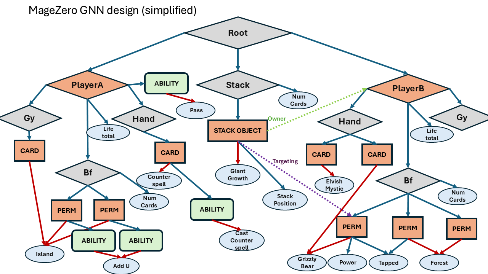

# MageZero: A Deck-Local AI Framework for Magic: The Gathering

### 1. High-Level Philosophy

MageZero is not a reinforcement learning (RL) agent in itself. It is a framework for training and managing deck-specific RL agents for Magic: The Gathering (MTG). Rather than attempting to generalize across the entire game with a monolithic model, MageZero decomposes MTG into smaller, more tractable subgames. Each deck is treated as a self-contained environment that can be mastered independently using focused, lightweight RL techniques.

This approach reframes the challenge of MTG AI from universal mastery to local optimization. By training agents within constrained, well-defined deck environments, MageZero can develop competitive playstyles and meaningful policy/value representations without requiring LLM-scale resources. 

---

### 2. Current Status (October 2026): **Third public alpha released**

MageZero v0.3.0-alpha is available on the [releases page](https://github.com/WillWroble/MageZero/releases/latest). This includes a precompiled XMage distribution and the `mz` CLI for running full training curricula end-to-end, as well as an included 16 opponent pool to train your constructed decks against.
Right now these 16 decks are being used to simulate the 2022-2025 standard metagame, if you are interested in lending your compute to this experiment with your own standard-ish deck contact me or join the discord.  

The project uses [XMage](https://github.com/magefree/mage), an Open Source complete MTG rules engine, as a gym environment. See this project's [XMage fork](https://github.com/WillWroble/mage) for the state vectorization and MCTS logic (relevant modules: `Player.AI.RL`, `Player.AI.MCTS`, `Mage.MageZero`).

See the [setup guide](https://github.com/WillWroble/MageZero/blob/main/setup_guide.md) for full installation and training instructions. For questions, join the Discord at [discord.gg/R6pB6xuEy9](https://discord.gg/R6pB6xuEy9) or reach me at <willwroble@gmail.com>.

Also see [FAQ and future goals](https://github.com/WillWroble/MageZero/blob/main/faq_goals.md).

---
### Quick Start
```bash
# Clone the repo
git clone https://github.com/WillWroble/MageZero
cd MageZero

# Download the XMage distribution from the latest release and extract into the repo root
# (creates xmage/ folder)

# Set up Python environment
python -m venv .venv
source .venv/bin/activate     # Windows: .venv\Scripts\activate
pip install -e .

# Add your deck
cp my_deck.dck xmage/decks/

# Edit configs/run.yml to point at your deck, then
mz train
```

That's the whole flow — one command drives data generation, dataset analysis, model evaluation, replay buffer management, and training across every generation in the curriculum. See the [setup guide](https://github.com/WillWroble/MageZero/blob/main/setup_guide.md) for details.

---

### 3. Self-Play Results (as of December 2025)

Below is data from 2 long-running RL tests against a pool of 5 minimax (greedy AI) opponents playing mono colored decks.
The decks chosen for RL ([UWTempo](https://moxfield.com/decks/Bl76TS_q6E-HZ4G-s9_dlQ) and [Standard-MonoU](https://moxfield.com/decks/Okxs-whgSkapj5kIXUgMPg)) were chosen deliberately for being extremely punishing for greedy AI. 
UWTempo's WR with minimax was 16%, with RL it reached 66%. for Standard-MonoU the minimax opponent pool contained itself, 
so you can see in the graph below how much worse the minimax AI was in the mirror.

For reference my estimate of the human WR against the 5 minimax bots:

| Opponent | MageZero WR | Human WR (est.) | Gap |
|----------|-------------|-----------------|-----|
| vs MonoB | 48% | ~65% | -17 |
| vs MonoG | 34.5% | ~50% | -15.5 |
| vs MonoR | 57% | ~60% | -3 |
| vs MonoW | 52% | ~70% | -18 |
| **Average (excl. mirror)** | **47.9%** | **~61%** | **-13** |

*MageZero pilots UWTempo (an aggressive tempo deck) against minimax opponents playing much weaker starter decks, UWTempo is difficult to learn but overall is much more powerful as you can see. (1 training generation = 1000 games)*

<p align="center">
  
  <br/>
</p>

*MageZero pilots Standard-MonoU (a reactive tempo deck) against minimax opponents playing similar power-level standard decks. Minimax performance varies by deck complexity - it plays straightforward creature decks like MonoG at near-human level but struggles with reactive strategies.*

<p align="center">
  
  <br/>
</p>

See results/roundrobin-trainlog.txt for raw data


**Current Simulation Metrics**

* Games/hour (local, 16 CPU threads, 300-sim MCTS budget): \~800 games/hour
* Single-thread MCTS sims/sec: \~300 (4ghz)
* 8-thread MCTS sims/sec: \~200 


---

### 3.2 Emergent Behavior

By far the most interesting emergent behavior to come from MageZero so far, came from the card [Cecil Death Knight](https://scryfall.com/card/fin/380/cecil-dark-knight-cecil-redeemed-paladin). While playing against the [Standard-MonoB](https://moxfield.com/decks/R3zCVSK78kWyOwzAUyHUJg) deck agent i've been training, I noticed from the logs it wasn't playing its one-drop, Cecil, despite having nothing else to do on the first 2 turns. I initially assumed this was a glitch as I was on the play and was curving out (playing the same deck myself). By the time it played it, (on turn 3 with 12 life), I realized what it was doing actually made perfect sense. If it had played Cecil, (a 2/3 deathtoucher) it would have stopped my attacks and it would have probably just sat there as a 2/3 the whole game. By letting me lower it's life total before playing it, Cecil immediatly becomes a threat, since on the next turn they can remove any blockers and flip it by attacking, which is exactly what it did. this is starting to feel like signs of life of a true AlphaZero agent. ie. completely weird, 'creative' play patterns that only come from pure, unbiased RL. an LLM bot (or a bot trained on human games) would never do this in a million years. I've played with Cecil on MTG arena and never thought of playing it this way. But next time I play standard I'll try this strategy, since it makes sense to me for many situations.

---
### 4. Game Engine & Feature Encoding

Within the XMage fork, Game state is captured via a custom `StateEncoder.java`, which converts each decision point into a graph-based representation

#### The state graph

<p align="center">
  
  <br/>
</p>

The game decomposes top-down into namespaces (the root, each player, each zone), the objects inside them, and the abilities on those objects. Everything at the bottom is a leaf-attribute: a name, a keyword, Tapped, Power, an ability's effect.

Pointers link one entity to another across the tree, like a spell to its target or a stack object to its owner.

#### Legend

| Node        | Meaning                                      |
|-------------|----------------------------------------------|
| Diamond     | Namespace                                    |
| Box         | Object, scored by the target prior           |
| Rounded box | Ability, scored by the priority policy prior |
| Circle      | Singleton leaf-attribute                     |

| Edge         | Meaning                                 |
|--------------|-----------------------------------------|
| Blue arrow   | Default edge                            |
| Red arrow    | Name                                    |
| Dotted arrow | Pointer (targeting, attached-to, owner) |

#### Node types

| TYPE         | Diagram     |                                                                                                                                                                                                                                  |
|--------------|-------------|----------------------------------------------------------------------------------------------------------------------------------------------------------------------------------------------------------------------------------|
| ROOT         | Diamond     | Top of the graph. Holds both players, the Stack, exile, and the game-level leaves: step, decision type, decision text.                                                                                                           |
| PLAYER       | Diamond     | Arguably a namespace, but kept as an entity so the encoding can be adopted to multiplayer without a complete rework. Holds its zones, life, counters, microdecisions, attachments, and Pass.                                     |
| ZONE         | Diamond     | Less an entity than a namespace. Kept as a node because special exile zones want object identity. Holds its cards and its size.                                                                                                  |
| STACK_OBJECT | Box         | One of the two dynamic types, strictly higher than permanents since it points to them. Holds its source, targets, position, modes, and abilities.                                                                                |
| PERMANENT    | Box         | The other dynamic type, higher than abilities. Holds its abilities, types, counters, state, and attachments.                                                                                                                     |
| CARD         | Box         | Used like more like an interface rather than a class: a PERMANENT and a STACK_OBJECT are both CARDs, but neither contains the other. Cards in hand, graveyard, and exile are CARD nodes, with name, types, mana cost, and color. |
| ABILITY      | Rounded box | Sits below permanents. What the priority policy prior scores: a card's cast ability, an activated ability, or Pass. Activated abilities are only encoded when playable.                                                          |
| LEAF         | Circle      | Singleton leaf-attribute. A new type of counter, new ability, or new dynamic attribute gets minted on the fly as a leaf token.                                                                                                   |

#### Features:
* **Entity based encoding**: MTG is fundamentally a set of objects with static and dynamic attributes. This decomposition allows the network to generalize to an unseen entity (Grizzly Bears) if it has attributes that it has already learned (power=2, toughness=2, type=creature, color=green etc.)
* **Open vocabulary**: Instead of trying to predefine the entire vocabulary of MTG, the encoder uses a hash table to tokenize new leaf nodes on the fly. This means as MTG evolves and more cards are added to the game, the network will naturally grow to include them without retraining.


### 5. Neural Network Architecture


#### GNN Architecture

MageZero's model is a graph neural network over a typed entity graph of the game state. The priority policy and target policy are baked into the graph: an action is the node it acts through, so the network scores nodes instead of a fixed table of action slots.

#### Network

| | |
|---|---|
| Width | 256 |
| Attention heads | 4 |
| FF size | 512 |
| Dropout | 0 |
| Bottom-up passes | 2 |
| Local-layers per node type | 2 (one per pass) |
| Global-layers | 2 |

**Embeddings.** Node types are ROOT, PLAYER, ZONE, STACK_OBJECT, PERMANENT, CARD, ABILITY, and LEAF. Each typed node starts from its type embedding. A leaf's embedding is its vocab row plus a numeric value bucket: exact values from -5 to 20, then 21-25, 26-30, 31-40, 41-60, and 61+. Every edge carries a label from a second vocab, and the label's embedding is added to the child's token as its parent reads it. Both vocabs are append-only, so a new card, counter, or ability mints a new row on the fly.

**Local-layers.** Each pass runs one local-layer per node type, bottom-up in this order:

```
ABILITY → CARD → PERMANENT → STACK_OBJECT → ZONE → PLAYER → ROOT
```

Every node attends over itself and its children (pre-norm transformer layer, GELU), and only the node's own output is kept. Children of an earlier type arrive already updated in the current pass. Children of the same type or a later one, which are the pointers (attachments, targets, linked exile), arrive from the previous pass. The two passes have separate weights.

**Global-layers.** A 2-layer transformer encoder over a CLS token plus every internal (non-leaf) node in the state, so any two entities can interact no matter where they sit in the tree.

**Heads.** Each head is its own MLP (256 → 256 → out).
- **Priority** scores every ABILITY node. Passing priority is itself an ability on the player.
- **Target** scores every CARD, PERMANENT, STACK_OBJECT, and PLAYER node.
- **Choose-use** is a 2-way yes/no read from CLS.
- **Value** is read from CLS, with tanh to [-1, 1].

**Training.** The policy heads train with KL divergence from the normalized MCTS visit counts to a softmax over every node of the head's types in the state. There is no legality mask: illegal nodes train toward zero along with legal ones the search didn't visit, because the prior's job is to say which moves are worth expanding, and the search already prunes illegal ones. Choose-use trains with the same KL over its two options, and value trains with MSE.

### Results

<!-- methodology and results -->
### 6. MCTS

MageZero uses the same combination of MCTS with Deep learning that Deep Mind's AlphaZero, Muzero and other variants have used to play Go, Chess, Shogi, and other strategy games at a superhuman level. Specifically we use the PUCT formula as was originally outlined in the AlphaZero paper. 

$$a^* = \arg\max_a \left[ Q(s,a) + c_{\text{puct}}  P(s,a)  \frac{\sqrt{N(s)}}{1 + N(s,a)} \right]$$


we use c = 1.0. but otherwise keep the formula the same. however there were many other modifications that needed to be made.

For one, unlike Chess, MTG has many different type of decision points. (priority, choosing targets, ordering triggers, attacking etc.) This is why we use a special policy head for each one, since all of these decisions can be game swinging and are highly learnable.

We also don't use and Dirichlet noise or temperature sampling like the original AlphaZero authors did. Instead, we found we were able to get stable network progression by increasing search depth since MTG already has a lot of inherent randomness. 

Another key difference was using a TD-style discounting blend between intermediate MCTS root scores, and the next value target. This is much more stable than terminal only and stays bounded for MCTS. ($0.9 \leq \lambda \leq 0.95$ )

$$
y_N = z
$$

$$
y_i = \lambda y_{i+1} + (1 - \lambda) h_i
$$

we also use a special blend for learning opponent playstyle when playing against other types of AI (eg minimax). We use the MCTS visits the agent had for the opponent at that node + K virtual visits for the observed action:

$$
\tilde N(s,a) = N_{\text{pred}}(s,a) + k [a = a_{\text{obs}}]
\quad
$$
$$
\qquad
\pi_{\text{opp}}(a \mid s) = \frac{\tilde N(s,a)}{\sum_b \tilde N(s,b)}
$$


### 7. Challenges

MageZero faces several research challenges that shape future development:

* **Imperfect Information**: Unlike games like Go or Chess, Magic: The Gathering is a game of imperfect information where the opponent's hand and library are hidden. Handling this requires new methods, potentially drawing on MuZero-style learned dynamics models.

* **Long-Horizon & Weak Reward Signals**: The consequences of an early decision may not become apparent for many turns. Credit assignment remains a core challenge and is why I feel the need for a high quality bootstrap.

* **Simulation Throughput**: MCTS simulations are computationally expensive and XMage is heap intensive. Optimizing throughput remains a persistent challenge.

* **Evaluation Methodology**: No gold standard exists for MTG AI benchmarking. Win rate against fixed opponents remains the main reference metric.

---

### 8. Future Goals

1. **LLM-Based Bootstrap Agent**: Replace the minimax bootstrap with a stronger LLM-based agent to provide higher-quality priors and value signals.
2. **AI vs AI Simulation Framework**: Build a general framework within XMage for fast AI vs AI simulations, enabling MageZero and other MTG AI projects to scale evaluation and training.
3. **Clean Up & Refactor**: Solidify the existing codebase for stability and readability.
4. **Micro-Decision Policies**: Extend the learning process to cover fine-grained decisions such as targeting.
5. **Simulation Efficiency**: Develop less memory intensive Java simulations that approach \~1,000 games/hour.
6. Consolidate/containerize the entire pipeline with OpenAI gym or similiar. This is for use of HPC clusters and ease of distribution/collaboration.

---

### 9. Sources and Inspirations

MageZero draws from a range of research traditions in reinforcement learning and game theory.

* **AlphaZero & MCTS**: The core self-play loop, use of a joint policy/value network, and the PUCT algorithm for tree search are heavily inspired by the work on AlphaGo and AlphaZero.

  * Silver, D., Schrittwieser, J., Simonyan, K., et al. (2017). *Mastering the game of Go without human knowledge*. Nature, 550(7676), 354–359.
  * Silver, D., Hubert, T., Schrittwieser, J., et al. (2018). *A general reinforcement learning algorithm that masters chess, shogi, and Go through self-play*. Science, 362(6419), 1140–1144.
* **MuZero**: Inspiration for blending MCTS root scores with discounted rewards and exploring the potential of learned dynamics models for handling hidden information and scaling simulations.

  * Schrittwieser, J., Antonoglou, I., Hubert, T., et al. (2020). *Mastering Atari, Go, Chess and Shogi by Planning with a Learned Model*. Nature, 588, 604–609.
* **Feature Hashing**: The dynamic state vectorization method is an application of the hashing trick, a standard technique for handling large-scale, sparse feature spaces in machine learning.

  * Weinberger, K., Dasgupta, A., Langford, J., Smola, A., & Attenberg, J. (2009). *Feature Hashing for Large Scale Multitask Learning*. Proceedings of the 26th Annual International Conference on Machine Learning.
* **Curriculum Learning**: Though currently on the backburner, the initial concept for a "minideck curriculum" is based on the principle of gradually increasing task complexity to guide the learning process.

  * Bengio, Y., Louradour, J., Collobert, R., & Weston, J. (2009). *Curriculum learning*. Proceedings of the 26th Annual International Conference on Machine Learning.****
